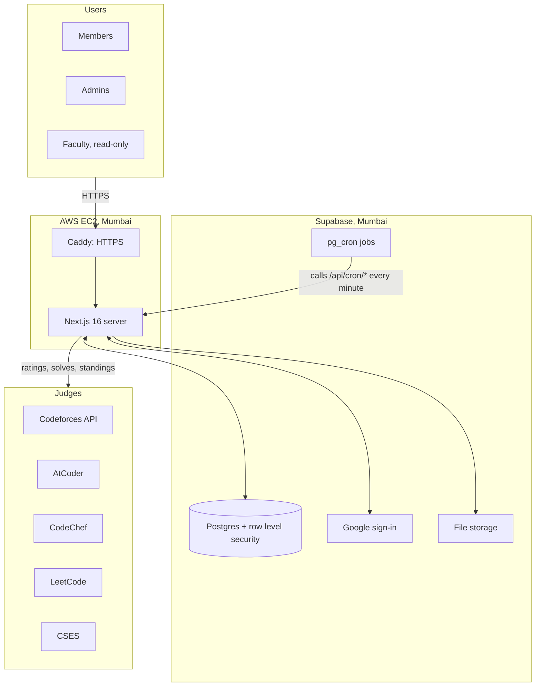
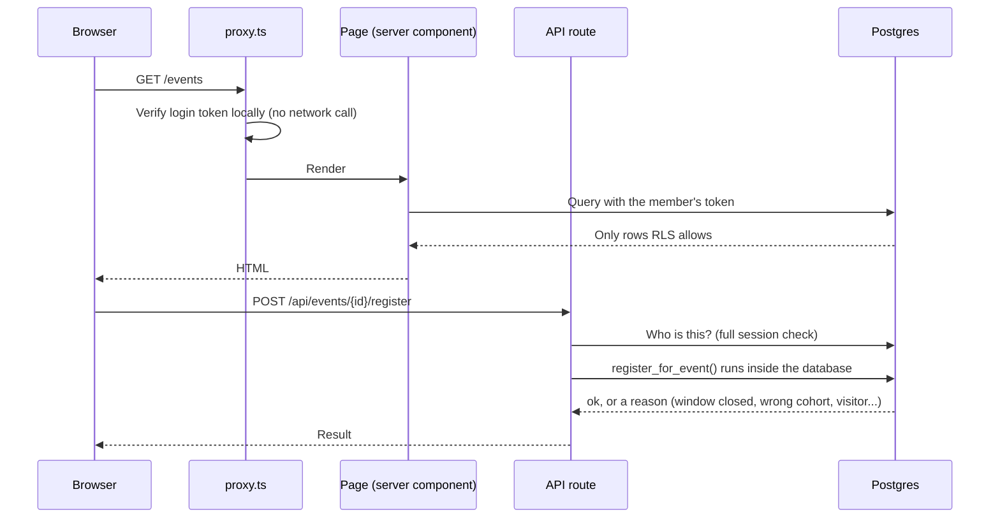
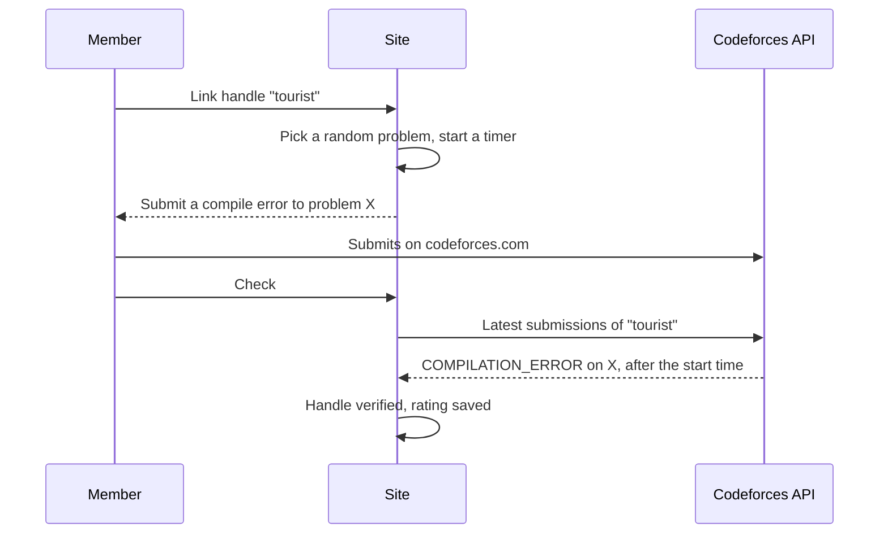
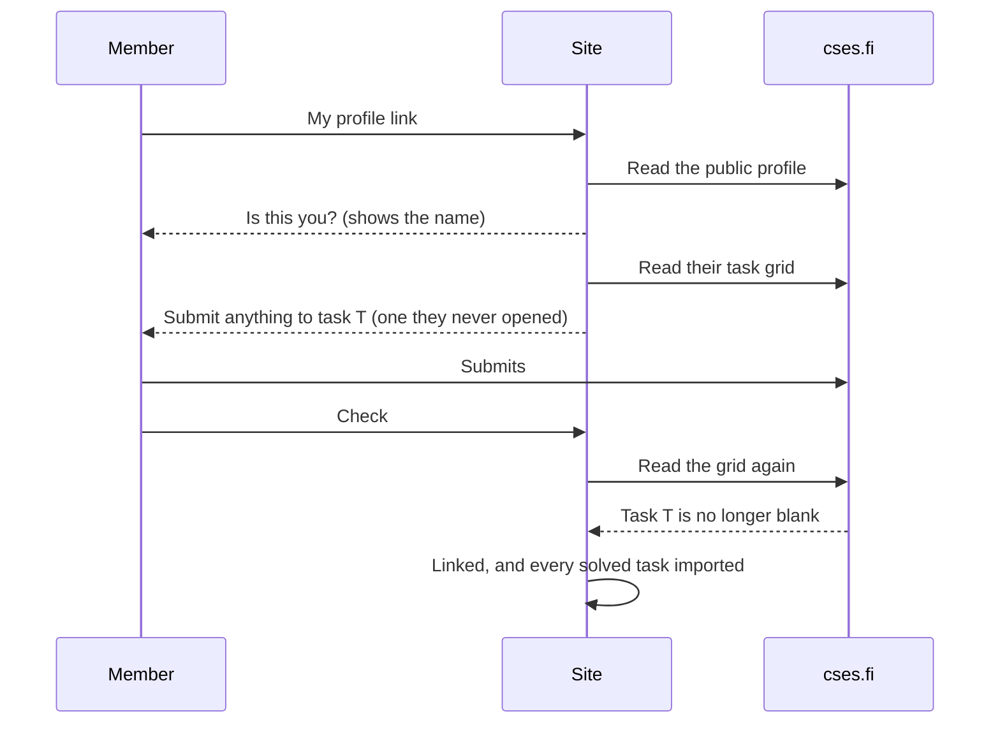
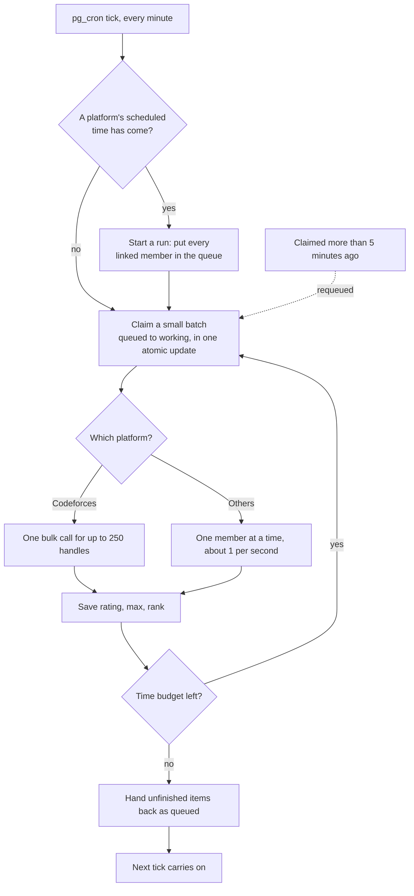
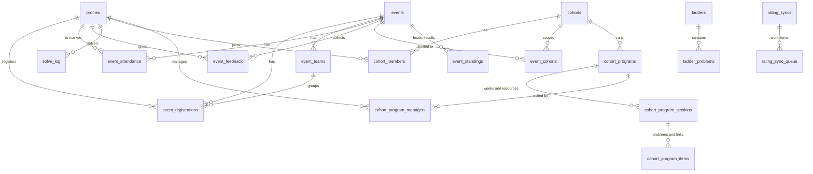
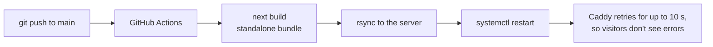

# Architecture

How the NlogN club platform fits together. The diagrams are written in Mermaid, so GitHub draws them.

## 1. The big picture

- **One server, one database, same city.** The app and the database both sit in Mumbai, so every query is a short hop.
- **The database does the scheduling.** `pg_cron` calls the app's cron endpoints, and the app does the actual work.
- **Judges are read-only.** The site never submits or judges code. It only reads public data.

## 2. A page load and a write

Pages read data with the member's own login token, so Postgres row level security decides what they see. Writes always go through an API route that checks the member's rights again.

Registration, teams and cancellations are Postgres functions. Two people can't both take the last seat, and the rules hold even if someone calls the database directly.

## 3. Proving account ownership

No judge offers a sign-in the site could use, so each one has its own proof. None of them ask for a password.

**Codeforces:** submit a compile error to a problem the site picks.

**CodeChef, AtCoder, LeetCode:** the site gives a one-time code, the member puts it in a profile field, and the site reads it back.

**CSES** has no API and no profile field. The site uses the colour of the member's task grid instead:

Attempts are capped at three an hour. All requests to CSES go one at a time, 1.2 seconds apart.

## 4. The rating sync queue

Codeforces allows a bulk lookup of 250 handles per call. CodeChef, AtCoder and LeetCode are read about once a second. Every cron tick also has a hard time limit. So a sync is a queue that many short ticks work through.

Safety rules:
- **Errors never wipe data.** A failed lookup leaves the old rating in place.
- **No unlinking on one bad answer.** A handle is unlinked only after three separate "not found" results, and only if a live re-check agrees.
- **Outages pause the run.** If a judge is down, its items go back in the queue for later.

Solved problems sync the same way, with their own schedule for each platform. CSES runs at 10 pm every night.

## 5. Data model (main tables)

Rules every table follows:
- **Row level security is always on.** Every table has explicit grants. The schema has no default access, so a new table is closed until it says otherwise.
- **Role columns are protected.** `is_admin`, `is_master` and `is_visitor` are guarded by a trigger, so nobody can promote themselves.
- **Times are stored in UTC** and shown in Indian time.
- **Public addresses use short numbers**, like `/events/100002` and `/cohorts/ch1003/programs/pg1001`. The internal ids never show.

## 6. Roles

| Role | Who | Can do |
|---|---|---|
| Member | Students with a college account | Link accounts, register, train, appear on leaderboards |
| Admin | Club leads | Everything a member can, plus run events, attendance, cohorts and programs |
| Program manager | A member an admin picks | Edit one training program in their own cohort |
| Visitor | Faculty | Read only, never on leaderboards |
| Master | The operator | System pages (access, syncs, maintenance), never takes part |

## 7. Shipping changes

The server itself is defined in Terraform: the instance, its fixed IP, the firewall, and two budget alerts (one for real charges, one for usage). Building happens on GitHub, never on the 2 GB server.

## 8. Keeping it fast

- **Login check on the server.** The login token is verified locally with the project's public key, instead of a network call on every page. That removed about a quarter of all database API traffic.
- **Links preload on intent.** A link loads its page when you hover or tap it, not as soon as it's on screen.
- **Counts are computed in SQL.** Things like "how many people solved this" never fetch thousands of rows.
- **The server is sized from real usage:** about 0.5% average CPU, under 1 GB of memory and 0.3 GB of traffic a day.
