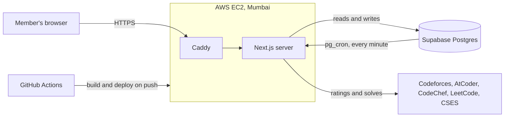

# NlogN Club Platform

I built and run the website for NlogN, the competitive programming club at Scaler School of Technology. It lives at [nlogn-sst.com](https://nlogn-sst.com). Only college accounts can sign in.

The source is private because the site holds real student data. This repo explains how it works and includes a few files from the real code. I'm happy to walk through the rest in an interview.

## Why it exists

A club with over a thousand members needs one place to run contests and sessions, take registrations and attendance, and rank people fairly. It also needs to know that a Codeforces handle really belongs to the student who claims it. This site does all of that.

## In numbers

As of November 2026, about four and a half months after launch:

**People**
- 1,152 members signed up
- 852 proved they own their Codeforces account, 616 linked AtCoder, 612 LeetCode and 559 CodeChef
- 174 members solved a problem in the last 30 days, 4,486 problems between them

**Events**
- 108 events: 74 contests, 28 sessions, 5 problem discussions and a challenge
- 4,156 registrations, about 60 per event; the biggest event had 300
- 388 teams formed for team contests
- 2,094 attendance marks, 91% present
- 467 feedback responses, averaging 4.5 out of 5

**Tracking**
- 62,458 solved problems tracked: 54,520 Codeforces, 5,717 AtCoder and 2,221 CSES
- 84 scheduled rating syncs, all completed

**Code**
- About 51,000 lines of TypeScript
- 70 API routes, 75 pages and 105 database migrations

## What members and admins get

- **Verified accounts.** Members prove they own each judge account without sharing a password.
- **Events.** Registration windows, solo or team entry, cohort-only events, attendance and feedback forms.
- **Leaderboards.** A club ranking weighted across Codeforces, AtCoder and CodeChef, plus boards built from contest standings.
- **Cohorts.** Training programs with weekly problem sets, each member's progress and a standings tab.
- **Ladders.** Problem ladders by rating, with progress bars and a leaderboard for each.
- **Profiles.** Rating history across platforms, a solve heatmap and stats for each platform.

## How it's built

The stack is Next.js 16, React and TypeScript on one EC2 server, which is set up with Terraform. Supabase Postgres stores the data and checks permissions with row level security. Scheduled jobs inside the database drive the background syncs.

[ARCHITECTURE.md](ARCHITECTURE.md) has the full picture, with diagrams for:
- the request flow
- account verification
- the sync queue
- the data model
- deploys

## The hard parts

**Proving who owns an account.** None of the judges offer a sign-in I could use, so each one needed its own method:
- **Codeforces:** you submit a compile error to a problem the site picks.
- **CodeChef, AtCoder, LeetCode:** you paste a one-time code into your profile.
- **CSES** has neither an API nor an editable profile. The site picks a task you've never opened, asks you to submit anything to it, then checks that the task changed colour on your public page.

**Syncing ratings without getting blocked.** Codeforces lets me look up 250 people in one call. The other sites only take about one request a second. So every sync run puts each member in a queue. A job takes small batches every minute, stops before its time limit and leaves the rest for the next run. A handle is only removed after three separate "user not found" answers and a fresh check, so a judge having a bad day can't unlink anyone.

**Keeping data safe.** The database itself decides who can see and change what:
- Members can't give themselves admin rights.
- Registration rules are checked inside the database, not just in the page.
- The one key that skips those rules is only used after the code has checked the person's rights in the same request.

**Keeping it fast and cheap.** I moved the app from serverless hosting to a single server, sized from real usage: about 0.5% CPU on average and under 1 GB of memory. Checking logins locally instead of calling the auth server removed about a quarter of all database API calls.

## Code samples

These files come straight from the private codebase. They won't run on their own.

| File | What it shows |
|---|---|
| [samples/rating-sync.ts](samples/rating-sync.ts) | The sync queue: batches, time limits, rate limits, safe unlinking |
| [samples/program-api.ts](samples/program-api.ts) | The permission check for editing a training program |
| [samples/program-managers.sql](samples/program-managers.sql) | A migration with its table, access rules and cleanup trigger |
| [samples/contest-url.ts](samples/contest-url.ts) | Reading every kind of Codeforces contest link |
| [samples/verified.ts](samples/verified.ts) | The rule for a fully verified member |

## What's next

- **An AI coach on every profile.** The site already holds each member's ratings over time, every solved problem with its rating and topics, contest results and attendance. An LLM can read that and say where someone is weak (say, strong at greedy but avoiding graphs above 1400), then pick the next problems and contests to reach a goal like "Specialist by March".
- **An in-browser code editor** that runs code in its own sandbox.
