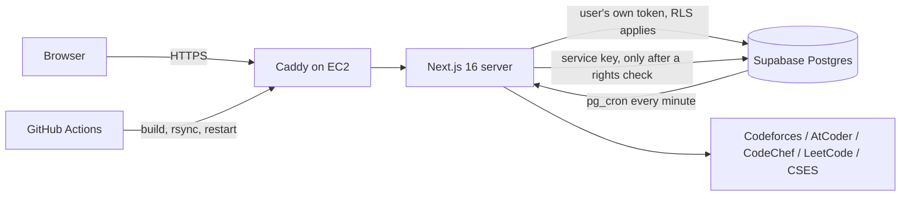

# NlogN Club Platform

The club portal for **NlogN**, the competitive programming club of Scaler School of Technology. Members sign in with their college Google account, link and verify their Codeforces, CodeChef, AtCoder and LeetCode accounts, register for contests and sessions, train in cohorts and climb club leaderboards and problem ladders. Admins run events, attendance, feedback and cohorts from the same site.

Live at **[nlogn-sst.com](https://nlogn-sst.com)** (sign-in is limited to college accounts).

> **Why the source is private:** the platform runs in production with real student data (emails, roll numbers, platform handles). This repository describes how it is built and includes a few self-contained source files. I'm happy to walk through the full codebase in an interview.

## In numbers

| | |
|---|---|
| Members signed up | 1,152 |
| Codeforces accounts verified | 852 |
| Events run | 108 |
| Event registrations | 4,156 |
| Attendance marks | 2,094 |
| Feedback responses | 467 |
| Solves tracked across platforms | 62,458 |
| Codebase | ~51k lines of TypeScript, 70 API routes, 75 pages, 105 database migrations |

Built from July 2026 onward, in production since the first month.

## The problem

Before the platform, the club ran on Google Forms, spreadsheets and WhatsApp. Registrations were copied by hand, attendance lived in sheets, nobody could tell which Codeforces handle belonged to which student, and there was no fair way to rank members across judges. The platform puts all of it in one place, with identities that are proven rather than self-reported.

## What it does

- **Verified identities.** Members prove they own each judge account without ever giving a password (see below). A blue seal appears once all four are linked.
- **Events.** Sessions, contests and problem-discussion events with registration windows, team registration by join code, cohort-only events, auto-registration, hosts, attendance and custom feedback forms.
- **Leaderboards.** A weighted club ranking (Codeforces 50%, AtCoder 25%, CodeChef 25%), filters by batch, cohort and platform, and contest boards built by merging frozen Codeforces standings.
- **Rating and solve sync.** Scheduled background jobs keep every member's ratings and solved problems current.
- **Cohorts and training programs.** Admins build programs made of weekly problem sets and resource lists. Members see their own ticks, how many of the cohort solved each problem, and a standings tab. Admins can make ordinary members "managers" of a single program.
- **Ladders.** Rated problem ladders with progress, a per-ladder leaderboard and pinned favourites.
- **Profiles.** A combined rating history chart across platforms, a solve heatmap and per-platform stats.
- **Roles.** Members, admins (run things and still take part), masters (operators only) and read-only visitors for faculty.

## Architecture

- **Next.js 16 App Router**, Server Components by default. Every write goes through a route handler, so each one has a stable path for checks and limits.
- **Supabase Postgres with row level security** on every table. Pages read with the member's own token, so the database itself decides what each person may see.
- **Background work runs on `pg_cron`.** Jobs inside the database call the site's cron endpoints, which work through a queue table in small, time-boxed slices.
- **Hosting:** one AWS EC2 server in Mumbai, next to the database, defined in **Terraform** (server, IP, firewall, budget alerts). GitHub Actions builds a standalone bundle and ships it on every push to `main`. Caddy handles HTTPS.

## Engineering highlights

**Proving account ownership without passwords.** Each judge needed its own method:
- **Codeforces:** the member submits a deliberate compile error to a randomly chosen problem within a time window, and the site confirms it through the API.
- **CodeChef, AtCoder, LeetCode:** a one-time token placed in a profile field, then read back.
- **CSES** has no API and no editable profile. The site picks a task the member has never touched and asks them to submit anything to it. It then reads their public task grid and checks that the cell changed.

**A rating sync that respects four very different sites.** Codeforces allows bulk lookups of 250 handles per call, while the scraped sites need about one request a second. Runs snapshot every linked member into a queue. Each cron tick claims items atomically with a conditional update, works within a 45-second budget and hands back anything unfinished. Stale claims are requeued after five minutes. A handle is only unlinked after three separate "not found" results *and* a live re-check, so a temporary failure on a judge's side can never unlink real members.

**Security model.** The rules live in the database, not just the UI:
- Role columns are protected by a trigger, so users can't promote themselves.
- Registration and team actions are `SECURITY DEFINER` functions that enforce windows, cohorts and roles.
- The service key is used only behind an explicit check in the same request.
- The schema has no default table grants, so every new table states exactly who can do what.

**Performance and cost.**
- Login checks were switched to local JWT verification (asymmetric signing keys). That removed the auth round trip, which had been about a quarter of all database API requests.
- Link prefetching moved from "on sight" to "on intent", because each visible link was costing two server requests.
- Solver counts come from SQL aggregate functions instead of fetching rows.
- The app moved from serverless hosting to a single server sized from measured usage: about 0.5% CPU on average and under 1 GB of RAM.

## Tech stack

TypeScript, React 19, Next.js 16, Node.js, Tailwind CSS v4, PostgreSQL (Supabase, RLS, `pg_cron`), SQL, AWS EC2, Terraform, GitHub Actions, Caddy, Linux. Light and dark themes, built to work on phones.

## Screenshots

| | |
|---|---|
|  |  |
|  |  |

## Source samples

Self-contained files taken from the private codebase. They show the style and approach; they are not runnable on their own.

| File | What it shows |
|---|---|
| [`samples/rating-sync.ts`](samples/rating-sync.ts) | The queue-based rating sync engine: atomic claims, time budgets, per-platform rate limits, safe unlinking |
| [`samples/program-api.ts`](samples/program-api.ts) | The authorization gate for editing a training program (admins, or that program's managers, checked on every call) |
| [`samples/program-managers.sql`](samples/program-managers.sql) | A migration: table, RLS policies, grants and a cleanup trigger |
| [`samples/contest-url.ts`](samples/contest-url.ts) | Parsing every shape of Codeforces contest link, including private group mashups |
| [`samples/verified.ts`](samples/verified.ts) | The verified-member rule |

## What's next

- An in-browser code editor with a sandboxed runner, kept in its own isolated container.
- A separate staging database, so changes are tested away from live data.
- Topic-wise ladders and weekly goals.
